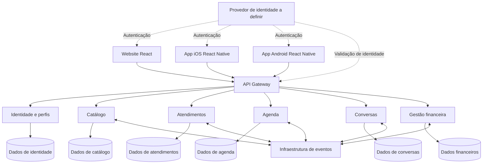

# Arquitetura do InkLink

## 1. Objetivo e contexto

Este documento estabelece a fundação arquitetural da nova aplicação InkLink, em complemento ao [requirements.md](requirements.md). Os requisitos descrevem os comportamentos esperados; este documento define a organização e as diretrizes para implementá-los.

A aplicação será criada do zero, com backend em .NET 10 e evolução para três frontends: website em React para web, aplicativo iOS em React Native e aplicativo Android em React Native. A implementação será incremental; os três canais não precisam ser entregues simultaneamente. O protótipo é referência de telas, identidade visual, navegação e usabilidade. Seu código, dados mockados, persistência local e simplificações não serão a base técnica da nova solução.

A arquitetura adotada é de microsserviços organizados por capacidades de negócio, com propriedade dos dados, contratos explícitos e possibilidade de implantação independente. Internamente, serviços com regras de negócio relevantes utilizarão Clean Architecture, casos de uso organizados por funcionalidade e princípios de Domain-Driven Design (DDD).

Este arquivo e os demais documentos de SDD são mutáveis. Registram as decisões atuais e serão atualizados em entregas incrementais. Não constituem uma implementação concluída nem fixam tecnologias ainda não escolhidas.

## 2. Decisões e princípios

| Tema | Diretriz adotada |
| --- | --- |
| Frontends | Três canais previstos: website em React para web, app iOS em React Native e app Android em React Native, organizados por funcionalidades e com áreas de cliente e artista. |
| Backend | Microsserviços em .NET 10, com limites definidos por domínio. |
| Modelagem | DDD para delimitar contextos e modelar regras complexas; cadastros simples não exigem modelagem artificialmente complexa. |
| Organização interna | Clean Architecture com dependências voltadas ao domínio e organização por casos de uso. |
| Leitura e escrita | CQRS simplificado, separando consultas e comandos sem exigir bancos distintos. |
| Dados | Cada serviço é responsável por seus próprios dados e migrações. |
| Comunicação | APIs para operações que exigem resposta imediata e eventos para propagação assíncrona. |
| Confiabilidade | Transações locais, Outbox, consumidores idempotentes e coordenação explícita quando necessária. |
| Evolução | Entregas pequenas de fluxos completos, com testes e revisão dos limites de responsabilidade. |
| Pagamentos | Processamento de pagamentos no site fora do escopo atual. Gestão financeira não equivale a cobrança. |

SOLID deve orientar responsabilidades, contratos e dependências:

- Responsabilidade única: separar transporte, coordenação do caso de uso, regra de negócio e infraestrutura.
- Aberto/fechado: permitir novas políticas ou integrações sem modificar partes não relacionadas.
- Substituição de Liskov: implementações devem cumprir os contratos e comportamentos esperados de suas abstrações.
- Segregação de interfaces: oferecer contratos pequenos e específicos para seus consumidores.
- Inversão de dependências: regras de negócio não dependem de banco, HTTP, broker ou provedor externo.

Esses princípios não exigem uma interface para cada classe, um serviço por entidade ou um padrão para toda operação. Abstrações devem atender a uma responsabilidade ou necessidade verificável.

## 3. Visão geral



O diagrama apresenta responsabilidades lógicas, não uma decisão sobre provedor de nuvem, quantidade de servidores ou produtos de infraestrutura. As ligações de eventos não significam que cada serviço consuma eventos de todos os demais.

O Gateway concentra a entrada das APIs e o roteamento. Os serviços continuam responsáveis pelas regras de negócio e pela autorização sobre seus recursos. O frontend não acessa bancos ou o broker diretamente.

## 4. Limites dos microsserviços

### 4.1 Identidade e perfis

Responsável pela identidade interna do usuário, funções e dados privados básicos de perfil. A autenticação poderá ser delegada a um provedor especializado, cuja escolha será registrada posteriormente.

- Mantém identificadores de usuários e vínculos com funções de cliente e artista.
- Disponibiliza os contratos necessários para identificação e perfis.
- Não concentra a autorização de todos os objetos de negócio: cada serviço verifica acesso aos próprios recursos.
- Não é responsável pelo portfólio, pelas propostas ou pelas mensagens.

A identidade da conta pertence a este contexto. A apresentação pública do artista pertence a Catálogo. Dados duplicados para apresentação devem ser projeções identificadas, com uma origem responsável pela atualização.

### 4.2 Catálogo

Responsável pela descoberta dos artistas e sua apresentação pública.

- Mantém perfil público do artista, estúdio, localização, estilos, preço de referência, portfólio e flashes.
- Mantém favoritos associados ao identificador do cliente.
- Oferece pesquisa, sugestões aproximadas e filtros.
- É responsável por atualizar e reconstruir um eventual índice de pesquisa.
- Não decide disponibilidade de horários, aceite de propostas ou autorização de envio de mensagens.

Um mecanismo de busca é um detalhe de infraestrutura deste contexto. Elasticsearch não está definido como obrigatório nesta versão.

### 4.3 Atendimentos

Responsável pelo ciclo de negócio da relação de serviço entre cliente e artista.

- Mantém solicitações, propostas, aceite e situação do atendimento.
- Identifica participantes e vincula referências a flash, reserva e conversa quando aplicáveis.
- Decide as transições permitidas do atendimento.
- Coordena processos que afetam seu ciclo de vida, incluindo encerramento e início de novo atendimento.
- Não ocupa horários diretamente nem grava mensagens em nome de Conversas.

O aceite é específico da proposta e do atendimento. Não há estado global compartilhado entre negociações.

### 4.4 Agenda

Responsável pela disponibilidade e ocupação do tempo do artista.

- Mantém disponibilidade, reservas e vínculos com cliente, artista e atendimento.
- Valida intervalos e impede sobreposição inclusive sob concorrência.
- É a origem oficial da situação da reserva e dos horários ocupados.
- Publica confirmações e alterações de reserva quando necessárias aos demais contextos.
- Não considera uma consulta de disponibilidade como garantia de reserva.

### 4.5 Conversas

Responsável pelo histórico, pelos participantes autorizados e pela aceitação de novas mensagens.

- Mantém conversas, mensagens, autoria, data/hora e referências aos atendimentos.
- Disponibiliza listagem e leitura individual para os participantes.
- Aplica localmente a permissão de escrita recebida por um processo autorizado de atendimento.
- Serializa as operações necessárias para impedir que uma mensagem seja aceita depois da confirmação do bloqueio.
- Preserva o histórico quando a escrita é bloqueada.

Atendimentos é a origem do ciclo de vida do serviço; Conversas é responsável pelo bloqueio efetivo da gravação de mensagens. Uma cópia assíncrona do estado não é suficiente, isoladamente, para garantir o encerramento imediato descrito nos requisitos.

### 4.6 Gestão financeira

Responsável pelos registros gerenciais e indicadores do artista.

- Mantém receitas e custos registrados e suas datas de referência.
- Calcula lucro e margem estimados, conforme as regras dos requisitos.
- Pode manter projeções de sessões concluídas e valores agendados recebidas dos contextos responsáveis.
- Distingue recebimento, conclusão de sessão e reserva futura.
- Não executa pagamento, cobrança ou compensação bancária.

O dashboard é uma composição de informações, não um novo microsserviço obrigatório. Dados de reservas, conversas e resultados podem ser obtidos por contratos ou projeções específicas. Gestão financeira não se torna proprietária dos dados operacionais dos demais serviços.

### 4.7 Granularidade e evolução

Os seis contextos constituem o mapa inicial de responsabilidades. Serão implementados por etapas conforme as funcionalidades forem entregues, sem criar serviços vazios apenas para completar o desenho.

Cada serviço implementado deve preservar fronteiras de execução, contratos e propriedade de dados. Alterações de limites serão documentadas. Separar entidades em processos sem autonomia de negócio não atende ao objetivo desta arquitetura.

## 5. Organização interna dos serviços

### 5.1 Camadas

| Camada | Responsabilidade | Exemplos |
| --- | --- | --- |
| API / Presentation | Transporte, identificação do solicitante, validação estrutural e tradução de respostas. | Endpoints, contratos HTTP, consumidores de entrada e adaptadores de tempo real quando aplicáveis. |
| Application | Coordenação dos casos de uso, autorização contextual, transações locais e portas de integração. | Solicitar orçamento, confirmar reserva, encerrar atendimento, enviar mensagem. |
| Domain | Regras, entidades, objetos de valor e transições de negócio. | Intervalo válido, proposta aceita, permissão de escrita de uma conversa. |
| Infrastructure | Implementação de persistência e integrações. | Acesso a dados, Outbox, publicação de eventos e clientes de serviços externos. |
| Tests | Verificação de comportamento e dependências. | Testes unitários, integração, contrato e concorrência. |

Fluxo de dependências de código:

```text
Application    -> Domain
Infrastructure -> Application e/ou Domain
API            -> Application
API            -> Infrastructure apenas para composição das dependências
Domain         -> nenhuma das demais camadas
```

Interfaces devem ficar na camada que define a necessidade. Entidades de domínio não são contratos HTTP nem eventos públicos compartilhados. O domínio não deve depender de framework web, broker ou detalhes de persistência.

### 5.2 Organização por funcionalidade

Os casos de uso serão organizados por funcionalidade, combinando Vertical Slices com as fronteiras das camadas.

```text
Agenda/
  API/
    Endpoints/
  Application/
    ConfirmarAgendamento/
    ConsultarDisponibilidade/
    ListarReservas/
    Abstractions/
  Domain/
    Reservas/
    Disponibilidade/
  Infrastructure/
    Persistence/
    Messaging/
    Integrations/
  Tests/
    Unit/
    Integration/
    Contract/
```

A estrutura é uma referência de responsabilidades. A quantidade de projetos e a nomenclatura física serão definidas na implementação. Casos simples podem usar uma organização menor, desde que respeitem dependências e isolamento.

### 5.3 Padrões internos

- **DDD seletivo:** agregados e objetos de valor para regras com invariantes; operações simples não exigem modelos complexos.
- **CQRS simplificado:** comandos alteram estado e consultas retornam dados de leitura. Não exige bancos separados, event sourcing, MediatR ou outra biblioteca específica.
- **Injeção de dependências:** fornecimento de persistência e integrações pelos pontos de composição da aplicação.
- **Repository quando útil:** contratos de persistência orientados às necessidades do domínio ou caso de uso, sem obrigação de um repositório genérico para toda entidade.
- **Eventos de domínio:** expressam acontecimentos internos do contexto. Eventos de integração são contratos públicos próprios e não expõem objetos internos do domínio.
- **Processos coordenados:** operações distribuídas são explícitas, com estado e recuperação quando necessário; não dependem de uma transação global entre bancos.

## 6. Dados e consistência

### 6.1 Propriedade dos dados

Cada serviço controla seus registros, esquema, migrações e credenciais de persistência. Serviços não acessam tabelas, views, procedimentos ou conexões privadas de outros contextos.

Um mesmo servidor físico de banco pode ser usado inicialmente, com separação lógica e de permissões. Essa opção não autoriza joins, chaves estrangeiras ou transações que atravessem bancos de serviços distintos.

As referências entre contextos usam identificadores e contratos. Projeções podem manter cópias dos dados necessários à consulta, registrando origem e estratégia de atualização. Não há um modelo de entidades compartilhado entre todos os serviços.

### 6.2 Transações locais e concorrência

Invariantes que precisam ser atômicas devem permanecer sob um único serviço e sua transação local. Em Agenda, a decisão de aceitar uma reserva e a proteção contra sobreposição são uma única operação consistente.

Consultar horários e inserir depois sem proteção concorrente não atende ao requisito. A implementação utilizará a estratégia adequada ao banco escolhido, como restrições, bloqueio ou serialização por recurso, com testes de requisições concorrentes.

### 6.3 Projeções e leitura

Catálogo, dashboard e listagens podem utilizar projeções com consistência eventual. Nesse caso, devem existir mecanismos de atualização, reprocessamento e identificação de defasagem quando relevante à experiência.

Projeções não são autoridade para confirmar reservas, permitir envio de mensagens após encerramento ou validar transições críticas. A leitura do resultado de uma operação recém-concluída deve oferecer uma resposta coerente, sem apresentar uma projeção atrasada como falha definitiva da operação.

### 6.4 Pesquisa e mídia

O catálogo mantém a fonte dos dados pesquisáveis. Um índice de pesquisa deve poder ser reconstruído a partir dessa origem e não será usado como banco principal das regras de negócio.

Arquivos de portfólio e flashes poderão ser mantidos em armazenamento próprio para mídia, com metadados sob responsabilidade de Catálogo. Provedor e políticas serão definidos posteriormente; o frontend não receberá credenciais administrativas desse armazenamento.

## 7. Comunicação e contratos

### 7.1 APIs síncronas

APIs serão usadas quando o solicitante precisa de resposta imediata ou de uma decisão do serviço responsável. Os contratos serão explícitos e documentados, incluindo validação, autorização, resultados, erros e compatibilidade.

Chamadas entre serviços devem possuir autenticação adequada, timeouts, cancelamento e comportamento definido diante de indisponibilidade. Cadeias longas de chamadas devem ser evitadas. O Gateway não coordena regras de negócio distribuídas.

### 7.2 Eventos de integração

Eventos propagam fatos já registrados, como proposta aceita, reserva confirmada ou atendimento encerrado. Os nomes e campos definitivos serão definidos junto aos fluxos, sem criar antecipadamente um catálogo completo de mensagens.

Os contratos devem permitir identificar evento, tipo, versão, contexto de negócio, data/hora, correlação e causalidade quando aplicável. Consumidores dependem do contrato publicado, não da implementação do produtor.

### 7.3 Entrega confiável

Quando uma alteração precisa gerar um evento externo, o registro de negócio e a entrada na Outbox devem ser gravados na mesma transação local. A publicação ocorre posteriormente e pode ser repetida.

Consumidores devem ser idempotentes. A deduplicação e a alteração local precisam ser coordenadas de modo que uma falha não registre processamento inexistente nem reaplique efeitos. Não se pressupõe entrega exatamente uma vez ou ordenação global.

Ordenação necessária ao negócio será definida por entidade ou atendimento, com versão ou sequência quando apropriado. Eventos antigos não podem reverter um encerramento ou habilitar indevidamente um atendimento anterior.

### 7.4 Processos distribuídos e Sagas

Sagas serão utilizadas quando um fluxo requer múltiplas alterações locais e etapas de recuperação ou compensação. Não são obrigatórias para consultas ou operações de um único serviço.

O processo deve ter responsável, identificador, estado durável, etapas repetíveis, tratamento de timeout e estratégia de reconciliação. Compensações são ações de negócio e não equivalem a desfazer uma transação global. A escolha entre orquestração e coreografia será registrada por fluxo, priorizando coordenação explícita nos ciclos críticos de Atendimentos.

## 8. Fluxos críticos de referência

### 8.1 Solicitação e proposta

1. O cliente seleciona um artista ou flash em Catálogo.
2. Atendimentos recebe o pedido, valida o solicitante e registra o contexto com as referências necessárias.
3. O artista apresenta uma proposta, e o cliente registra o aceite naquela proposta específica.
4. A criação ou habilitação da conversa é coordenada com Conversas conforme a etapa de atendimento permitida.
5. O aceite não cria recebimento nem reserva automaticamente um horário.

A captura de descrições e valores de referência deve preservar o contexto da negociação quando o catálogo mudar. A política exata de snapshots será detalhada nos contratos.

### 8.2 Confirmação de agendamento

1. O caso de uso identifica cliente, artista, atendimento e intervalo solicitado.
2. Agenda valida disponibilidade e conflitos e confirma a reserva em transação local protegida contra concorrência.
3. A reserva confirmada gera uma publicação confiável para os contextos interessados.
4. Atendimentos coordena as consequências sobre o serviço e a habilitação de conversa quando aplicável.
5. O usuário recebe uma indicação compatível com o estágio real do processo: reserva confirmada e atendimento preparado não devem ser confundidos enquanto houver coordenação pendente.

Falhas entre etapas exigem repetição idempotente e reconciliação. Regras de liberação ou compensação de uma reserva serão detalhadas quando o fluxo for implementado. Um timeout não autoriza criar uma segunda reserva sem verificar a operação anterior.

### 8.3 Encerramento e bloqueio do chat

A regra de RF14 exige que, depois da confirmação de encerramento, novas mensagens não sejam aceitas. Apenas consumir posteriormente um evento de encerramento deixaria uma janela incompatível com essa regra.

Diretriz de coordenação para a implementação:

1. Atendimentos registra de forma durável o pedido autorizado de encerramento e inicia sua coordenação. Um estágio técnico pendente pode existir sem equivaler ao estado de negócio `ENCERRADO`.
2. Conversas recebe uma operação idempotente de bloqueio do atendimento, verifica sua origem e grava o bloqueio de forma atômica em relação à aceitação de mensagens.
3. Operações concorrentes de mensagem e bloqueio possuem uma ordem consistente no serviço Conversas. Uma mensagem só pode ser aceita antes do bloqueio efetivo, nunca depois dele.
4. Conversas confirma o bloqueio durável. Só então Atendimentos conclui o encerramento e retorna ou disponibiliza sua confirmação definitiva.
5. Se houver timeout ou falha intermediária, o processo permanece recuperável. A interface informa pendência ou indisponibilidade e não declara o serviço definitivamente encerrado antes do bloqueio confirmado.

A repetição do comando não deve reabrir o chat. Caso o bloqueio tenha ocorrido e a conclusão do atendimento falhe, o processo deve ser reconciliado; não se desbloqueia automaticamente por ausência momentânea de resposta. Mensagens já aceitas antes da barreira de bloqueio permanecem no histórico, ainda que sua entrega visual ocorra depois.

O mecanismo concreto de ordenação, confirmação e recuperação será especificado antes da implementação do fluxo, incluindo testes de corrida e falhas parciais. A garantia de segurança do encerramento tem prioridade sobre permitir envio durante indisponibilidade.

### 8.4 Novo atendimento após encerramento

O histórico anterior é preservado. Um novo agendamento confirmado inicia a coordenação de um novo contexto de atendimento e da respectiva permissão de escrita, sem apagar mensagens ou alterar retroativamente o serviço concluído.

Conversas deve distinguir a autorização do novo atendimento da autorização antiga, mesmo que a interface apresente um histórico contínuo por par cliente/artista. Eventos e comandos atrasados de um atendimento não podem habilitar ou bloquear indevidamente outro.

A forma visual de agrupar conversas continua aberta, conforme os requisitos. A correlação entre reserva, atendimento e mensagens é obrigatória em qualquer alternativa.

### 8.5 Dashboard e finanças

Receitas e custos são registrados em Gestão financeira. Sessões concluídas, reservas e quantidade de conversas podem compor projeções gerenciais ou ser consultadas em seus contextos de origem.

Reservar ou encerrar um atendimento não registra automaticamente recebimento financeiro. Indicadores usam suas datas e regras de cálculo, e o dashboard distingue resultados realizados, estimativas e valores agendados. Projeções devem ser reconstruíveis sem duplicar receitas ou despesas.

## 9. Frontends web, iOS e Android

A experiência evoluirá para três frontends, todos baseados no ecossistema React:

| Canal | Tecnologia de referência | Característica |
| --- | --- | --- |
| Website | React para web, com React DOM | Interface executada no navegador. |
| Aplicativo iOS | React Native para iOS | Aplicativo com componentes e integrações nativas da plataforma. |
| Aplicativo Android | React Native para Android | Aplicativo com componentes e integrações nativas da plataforma. |

iOS e Android não exigem frameworks React distintos: React Native atende às duas plataformas, com adaptações específicas quando necessárias. Cada canal terá sua própria experiência, configuração de execução, testes e processo de publicação. Isso não obriga a existência de três repositórios ou de três bases de código totalmente independentes.

### 9.1 Organização por funcionalidades

Os frontends serão organizados por funcionalidades de negócio, como catálogo, atendimentos, conversas, agenda e gestão financeira. As áreas de cliente e artista terão navegação e composição adequadas a cada canal.

A estrutura lógica de referência inclui:

- Website React: inicialização, rotas, funcionalidades e componentes próprios do navegador.
- App iOS React Native: entrada e configuração iOS, navegação e integrações da plataforma.
- App Android React Native: entrada e configuração Android, navegação e integrações da plataforma.
- Código compartilhável: contratos de API, clientes de transporte e lógica de apresentação independente da plataforma, quando o compartilhamento trouxer benefício concreto.

A estrutura física poderá usar uma base React Native compartilhada entre iOS e Android, projetos separados ou um monorepositório. Essa escolha será registrada posteriormente. Componentes DOM, CSS e APIs de navegador não são presumidos reutilizáveis em React Native. Regras de negócio oficiais permanecem no backend.

### 9.2 Integração com os serviços

- Os três canais consomem as mesmas capacidades de negócio por contratos de backend compatíveis.
- O API Gateway é o ponto de entrada das APIs. Um Backend for Frontend (BFF) específico por canal poderá ser introduzido se houver necessidade de composição ou adaptação; não é obrigatório nesta fundação.
- Clientes móveis podem permanecer em versões anteriores após uma atualização do backend. Contratos devem considerar essa coexistência, evitando exigir atualização simultânea de todos os aplicativos.
- Identificação e autorização são verificadas pelo backend em todos os canais. Cada plataforma usará mecanismos adequados para sua sessão e armazenamento seguro; a implementação será detalhada posteriormente.
- O frontend controla a experiência, mas não é autoridade para permissões, valores aprovados, disponibilidade ou estado do serviço.

### 9.3 Usabilidade e evolução incremental

- O website será orientado pela experiência web do protótipo. Os aplicativos adaptarão os mesmos fluxos ao contexto móvel, sem exigir reprodução literal das telas.
- Estado de interface é separado dos dados de negócio obtidos pelas APIs.
- Pesquisa livre oferece sugestões; filtros mantêm seu comportamento específico. Respostas antigas não devem substituir sugestões de uma pesquisa mais recente.
- Listagem e leitura individual de conversas permanecem experiências distintas, com navegação adequada à plataforma.
- Estados de carregamento, erro, ausência de dados e coordenação pendente devem ser explícitos.
- Bibliotecas de rotas, cache, gestão de estado, atualização de mensagens e a escolha entre Expo e configuração nativa de React Native serão definidas posteriormente.
- Entregas podem começar pelo website e incorporar iOS e Android depois. A sequência será definida no planejamento, sem exigir a implantação dos três canais na primeira entrega.
- Recursos como funcionamento offline, notificações push e integrações específicas dos dispositivos não entram no escopo apenas pela previsão dos aplicativos.
- Essa divisão por canais não exige microfrontends.

## 10. Segurança, resiliência e observabilidade

### 10.1 Identificação e autorização

A autenticação será integrada a um mecanismo apropriado, a definir. Gateway e serviços validam os contratos de identidade pertinentes. Cada serviço verifica autorização sobre seus próprios recursos, inclusive participação na conversa e vínculo com atendimento, artista e reserva.

Credenciais entre serviços são distintas das credenciais de usuários. O acesso externo às APIs e a comunicação interna devem ser protegidos conforme o ambiente. Segredos são fornecidos por configuração segura, nunca pelo frontend ou por arquivos versionados.

### 10.2 Resiliência

Integrações usam limites de tempo, cancelamento e tentativas controladas. Repetição automática de uma escrita exige idempotência ou uma condição que torne sua repetição segura.

Circuit breakers, isolamento de recursos, filas e controle de carga serão aplicados onde houver necessidade concreta. Falhas permanentes ou mensagens não processáveis devem permitir diagnóstico e reprocessamento controlado, sem ciclos infinitos de repetição.

### 10.3 Observabilidade

Os serviços devem produzir logs estruturados, métricas e rastreamento distribuído, permitindo acompanhar uma operação por suas chamadas e eventos. Contexto de correlação deve ser propagado e não substitui o identificador idempotente de uma operação.

A base deve permitir observar falhas de API, latência, conflitos de reserva, atraso de projeções, publicações pendentes e processos distribuídos incompletos. Logs não devem expor credenciais ou conteúdo integral de conversas por padrão.

Health checks e sinais de prontidão devem refletir sua finalidade, evitando transformar indisponibilidade de um contexto em reinício indiscriminado de todos os serviços. Ferramentas, metas e limites serão definidos com o ambiente operacional.

## 11. Testes e critérios arquiteturais

A verificação deve incluir:

- Testes unitários de regras e transições de domínio.
- Testes de integração de persistência, transações e migrações.
- Testes de contratos entre APIs, produtores e consumidores de eventos.
- Testes de autorização e isolamento de dados.
- Testes de concorrência na agenda e na relação entre envio de mensagem e bloqueio.
- Testes de repetição, deduplicação, ordem de eventos e retomada após falhas.
- Testes de interface e fluxos completos, incluindo acessibilidade e responsividade.
- Verificações de dependências para impedir acesso a camadas e dados de outros serviços.

Critérios de conformidade da arquitetura:

1. Serviços podem ser compilados, testados e publicados sem exigir publicação simultânea dos demais quando seus contratos permanecem compatíveis.
2. Nenhum serviço acessa o banco privado de outro nem referencia sua implementação interna.
3. Domain permanece independente da infraestrutura e da camada de transporte.
4. Reservas conflitantes não são confirmadas sob concorrência.
5. Encerramento definitivo não é confirmado antes do bloqueio de mensagens.
6. Repetições de operações e eventos não geram duplicações indevidas.
7. Consultas eventualmente consistentes não decidem invariantes críticas.
8. O frontend não utiliza dados mockados ou armazenamento local como fonte oficial dos dados de produção.

## 12. Entrega incremental e escalabilidade

A abordagem ágil será aplicada por entregas pequenas de capacidades utilizáveis. Cada entrega atualiza requisitos, decisões, contratos e testes necessários à funcionalidade, sem exigir que todas as escolhas futuras sejam resolvidas antecipadamente.

A nova aplicação terá repositório próprio denominado `InkLink-Platform`, separado de `INKLINK-Prototype`, e caminho local `C:\Users\INFIS001125\Documents\ChatGPT\InkLink-Platform`. O SDD fica em `docs/` e a implementação em `src/`. O repositório do produto concentra a fonte oficial desses documentos; cópias no protótipo não devem ser mantidas como documentação concorrente. A organização interna de serviços, testes e frontends será detalhada em T00.02 e nas decisões posteriores. Pipelines deverão identificar componentes afetados sem eliminar a autonomia de publicação dos serviços.

O desenvolvimento local deve possuir instruções para iniciar os componentes necessários e suas dependências. Imagens e ambientes reproduzíveis poderão ser utilizados. Produtos de contêiner, orquestração e nuvem serão escolhidos posteriormente.

A escalabilidade deve considerar o perfil de carga de cada serviço. Catálogo e consultas, conexões de chat, gravação de mensagens e confirmação de reservas têm necessidades diferentes. Replicar instâncias exige tratar estado compartilhado, conexões, consumidores e concorrência de forma apropriada; a adoção de microsserviços, isoladamente, não garante capacidade ou desempenho.

Não há obrigação inicial de Kubernetes, microfrontends, event sourcing, banco por entidade ou uma biblioteca de domínio comum. Infraestrutura adicional será introduzida com necessidade demonstrada e decisão registrada.

## 13. Decisões a detalhar nas próximas etapas

Continuam abertas, sem bloquear esta fundação:

- Organização interna de `src/`, projetos, testes e nomes definitivos dos serviços; o repositório próprio `InkLink-Platform` e a separação `docs/`–`src/` já foram definidos.
- Compartilhamento de código entre web, iOS e Android, estrutura React Native, ferramentas e processos de publicação por canal.
- Provedor de identidade e fluxo de autenticação.
- Banco de dados e estratégia de concorrência de Agenda.
- Gateway, broker, ferramentas de Outbox e coordenação de processos.
- Contratos HTTP e de eventos, versionamento e compatibilidade.
- Protocolo concreto de encerramento e habilitação de conversa por novo atendimento.
- Tecnologia de atualização de mensagens e escala das conexões.
- Mecanismo de pesquisa e armazenamento de mídia.
- Registro financeiro, composição do dashboard e políticas de atualização das projeções.
- Infraestrutura, automação de entrega, observabilidade e metas de operação.

As escolhas serão registradas conforme surgirem, preferencialmente com contexto, decisão, alternativas e consequências. Mudanças que afetem comportamento também devem atualizar os requisitos. Este arquivo não autoriza inferir uma ferramenta ou política de negócio apenas porque ela é comum em determinada arquitetura.

## 14. Referências conceituais

As referências apoiam o desenho e não impõem provedores ou produtos específicos:

- [Análise de domínio e limites de serviços — Microsoft](https://learn.microsoft.com/en-us/azure/architecture/microservices/model/domain-analysis).
- [Microsserviço orientado a DDD — Microsoft](https://learn.microsoft.com/en-us/dotnet/architecture/microservices/microservice-ddd-cqrs-patterns/ddd-oriented-microservice).
- [Autonomia de dados em microsserviços — Microsoft](https://learn.microsoft.com/en-us/dotnet/architecture/microservices/multi-container-microservice-net-applications/microservice-application-design).
- [Padrões de arquitetura para microsserviços — Microsoft](https://learn.microsoft.com/en-us/azure/architecture/microservices/design/patterns).
- [Padrão Saga — Microsoft](https://learn.microsoft.com/en-us/azure/architecture/patterns/saga).
