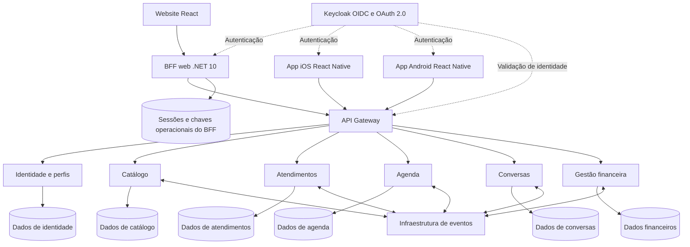

# Arquitetura do InkLink

## 1. Objetivo e contexto

Este documento estabelece a fundação arquitetural da nova aplicação InkLink, em complemento ao [requirements.md](requirements.md). Os requisitos descrevem os comportamentos esperados; este documento define a organização e as diretrizes para implementá-los.

A aplicação será criada do zero, com backend em .NET 10 e evolução para três frontends: website em React para web, aplicativo iOS em React Native e aplicativo Android em React Native. A implementação será incremental; os três canais não precisam ser entregues simultaneamente. O protótipo é referência de telas, identidade visual, navegação e usabilidade. Seu código, dados mockados, persistência local e simplificações não serão a base técnica da nova solução.

A arquitetura adotada é de microsserviços organizados por capacidades de negócio, com propriedade dos dados, contratos explícitos e possibilidade de implantação independente. Internamente, serviços com regras de negócio relevantes utilizarão Clean Architecture, casos de uso organizados por funcionalidade e princípios de Domain-Driven Design (DDD).

Este arquivo e os demais documentos de SDD são mutáveis. Registram as decisões atuais e serão atualizados em entregas incrementais. Não constituem uma implementação concluída nem fixam tecnologias ainda não escolhidas.

## 2. Decisões e princípios

| Tema | Diretriz adotada |
| --- | --- |
| Frontends | Três canais previstos: website em React para web, app iOS em React Native e app Android em React Native, organizados por funcionalidades e com áreas de cliente e artista. |
| Backend | Microsserviços em .NET 10, com limites definidos por domínio. |
| Modelagem | DDD para delimitar contextos e modelar regras complexas; cadastros simples não exigem modelagem artificialmente complexa. |
| Organização interna | Clean Architecture com dependências voltadas ao domínio e organização por casos de uso. |
| Leitura e escrita | CQRS simplificado, separando consultas e comandos sem exigir bancos distintos. |
| Dados | Cada serviço é responsável por seus próprios dados e migrações. |
| Comunicação | APIs para operações que exigem resposta imediata e eventos para propagação assíncrona. |
| Confiabilidade | Transações locais, Outbox, consumidores idempotentes e coordenação explícita quando necessária. |
| Evolução | Entregas pequenas de fluxos completos, com testes e revisão dos limites de responsabilidade. |
| Pagamentos | Processamento de pagamentos no site fora do escopo atual. Gestão financeira não equivale a cobrança. |

SOLID deve orientar responsabilidades, contratos e dependências:

- Responsabilidade única: separar transporte, coordenação do caso de uso, regra de negócio e infraestrutura.
- Aberto/fechado: permitir novas políticas ou integrações sem modificar partes não relacionadas.
- Substituição de Liskov: implementações devem cumprir os contratos e comportamentos esperados de suas abstrações.
- Segregação de interfaces: oferecer contratos pequenos e específicos para seus consumidores.
- Inversão de dependências: regras de negócio não dependem de banco, HTTP, broker ou provedor externo.

Esses princípios não exigem uma interface para cada classe, um serviço por entidade ou um padrão para toda operação. Abstrações devem atender a uma responsabilidade ou necessidade verificável.

## 3. Visão geral



O diagrama apresenta responsabilidades lógicas, não uma decisão sobre provedor de nuvem, quantidade de servidores ou produtos de infraestrutura. As ligações de eventos não significam que cada serviço consuma eventos de todos os demais.

O Gateway concentra a entrada das APIs e o roteamento. A implementação inicial utiliza YARP, conforme a [decisão 0007](decisions/0007-p02-identity-and-sessions.md), que também detalha funções e sessão web; a renovação da sessão (30 minutos sem uso, 8 horas no total, refresh token rotativo mantido no BFF) está na [decisão 0019](decisions/0019-p10-session-renewal.md). Os serviços continuam responsáveis pelas regras de negócio e pela autorização sobre seus recursos. O frontend não acessa bancos ou o broker diretamente.

## 4. Limites dos microsserviços

### 4.1 Identidade e perfis

Responsável pela identidade interna do usuário, funções e dados privados básicos de perfil. A autenticação será delegada ao Keycloak conforme a [decisão 0003](decisions/0003-authentication.md). Identity mantém os perfis e vínculos próprios da aplicação, sem armazenar as credenciais administradas pelo provedor.

- Mantém identificadores de usuários e vínculos com funções de cliente e artista.
- Disponibiliza os contratos necessários para identificação e perfis.
- Não concentra a autorização de todos os objetos de negócio: cada serviço verifica acesso aos próprios recursos.
- Não é responsável pelo portfólio, pelas propostas ou pelas mensagens.

A identidade da conta pertence a este contexto. A apresentação pública do artista pertence a Catálogo. Dados duplicados para apresentação devem ser projeções identificadas, com uma origem responsável pela atualização.

### 4.2 Catálogo

Responsável pela descoberta dos artistas e sua apresentação pública.

- Mantém perfil público do artista, estúdio, localização, estilos, preço de referência, portfólio e flashes.
- Mantém favoritos associados ao identificador do cliente.
- Oferece pesquisa, sugestões aproximadas e filtros.
- É responsável por atualizar e reconstruir um eventual índice de pesquisa.
- Não decide disponibilidade de horários, aceite de propostas ou autorização de envio de mensagens.

Um mecanismo de busca é um detalhe de infraestrutura deste contexto. Em P03, Catalog utiliza PostgreSQL com pg_trgm, projeção transacional de termos e reconstrução administrativa a partir dos perfis oficiais. A alimentação por API autenticada do próprio Artist, a integração delegada com Identity, os contratos de mídia, os filtros, os cursores e os favoritos estão detalhados na [decisão 0008](decisions/0008-p03-catalog-and-search.md). Não há referência de código ou acesso ao banco de Identity. Elasticsearch não é obrigatório nesta versão.

### 4.3 Atendimentos

Responsável pelo ciclo de negócio da relação de serviço entre cliente e artista.

- Mantém solicitações, propostas, aceite e situação do atendimento.
- Identifica participantes e vincula referências a flash, reserva e conversa quando aplicáveis.
- Decide as transições permitidas do atendimento.
- Coordena processos que afetam seu ciclo de vida, incluindo encerramento e início de novo atendimento.
- Não ocupa horários diretamente nem grava mensagens em nome de Conversas.

O aceite é específico da proposta e do atendimento. Não há estado global compartilhado entre negociações.

P04 implementa Engagements com persistência privada, snapshots obtidos pelo contrato técnico de Catalog, pedidos idempotentes, histórico de versões e aceite da proposta vigente. Casos de uso em Application coordenam as transições de Domain; Infrastructure oferece transação e bloqueio local da linha do atendimento para serializar apresentação e aceite. A [decisão 0009](decisions/0009-p04-engagements.md) e os [contratos de integração](contracts/p04-integrations.md) delimitam a negociação inicial. A primeira publicação confiável foi acrescentada em P05, com Outbox transacional; não há reserva ou recebimento automático.

### 4.4 Agenda

Responsável pela disponibilidade e ocupação do tempo do artista.

- Mantém disponibilidade, reservas e vínculos com cliente, artista e atendimento.
- Valida intervalos e impede sobreposição inclusive sob concorrência.
- É a origem oficial da situação da reserva e dos horários ocupados.
- Publica confirmações e alterações de reserva quando necessárias aos demais contextos.
- Não considera uma consulta de disponibilidade como garantia de reserva.

P06 implementa Scheduling em banco próprio com disponibilidade por data/fuso IANA, confirmação pelo artista após proposta aceita, reservas idempotentes e restrição de exclusão GiST/tstzrange por artista. Alteração de disponibilidade e reserva usam o mesmo bloqueio local do calendário. Domain concentra a proteção das janelas reservadas e o fuso padrão; Application coordena e Infrastructure persiste os parâmetros recebidos. Contratos técnicos autenticados fornecem contexto/nomes; nenhuma tabela ou implementação alheia é acessada. Confirmação publica Outbox e gera recibo técnico idempotente em Atendimentos, sem concluir a coordenação de P07. Políticas e limites estão na [decisão 0011](decisions/0011-p06-scheduling.md).

### 4.5 Conversas

Responsável pelo histórico, pelos participantes autorizados e pela aceitação de novas mensagens.

- Mantém conversas, mensagens, autoria, data/hora e referências aos atendimentos.
- Disponibiliza listagem e leitura individual para os participantes.
- Aplica localmente a permissão de escrita recebida por um processo autorizado de atendimento.
- Serializa as operações necessárias para impedir que uma mensagem seja aceita depois da confirmação do bloqueio.
- Preserva o histórico quando a escrita é bloqueada.

Atendimentos é a origem do ciclo de vida do serviço; Conversas é responsável pelo bloqueio efetivo da gravação de mensagens. Uma cópia assíncrona do estado não é suficiente, isoladamente, para garantir o encerramento imediato descrito nos requisitos. P05 implementa Messaging com banco próprio, Inbox idempotente, histórico por sequência e envio/bloqueio coordenados em Application sob transação/bloqueio local de Infrastructure. A abertura é coordenada por OpenConversation em Application, com Inbox e persistência atomicamente oferecidas por Infrastructure. O consumidor aplica orçamento durável de dez tentativas e encaminha falhas esgotadas para diagnóstico. A abertura vem da Outbox de Engagements via RabbitMQ; o publicador fica em Infrastructure e os hosts compõem por extensões. A apresentação consulta estado/snapshot de Atendimentos e nomes de Identity por contratos autorizados, sem referências às implementações ou bancos alheios. A [decisão 0010](decisions/0010-p05-messaging.md) delimita a barreira local e a evolução em P07.

### 4.6 Gestão financeira

Responsável pelos registros gerenciais e indicadores do artista.

- Mantém receitas e custos registrados e suas datas de referência.
- Calcula lucro e margem estimados, conforme as regras dos requisitos.
- Pode manter projeções de sessões concluídas e valores agendados recebidas dos contextos responsáveis.
- Distingue recebimento, conclusão de sessão e reserva futura.
- Não executa pagamento, cobrança ou compensação bancária.

O dashboard é uma composição de informações, não um novo microsserviço obrigatório. Dados de reservas, conversas e resultados podem ser obtidos por contratos ou projeções específicas. Gestão financeira não se torna proprietária dos dados operacionais dos demais serviços.

### 4.7 Granularidade e evolução

Os seis contextos constituem o mapa inicial de responsabilidades. Serão implementados por etapas conforme as funcionalidades forem entregues, sem criar serviços vazios apenas para completar o desenho.

Cada serviço implementado deve preservar fronteiras de execução, contratos e propriedade de dados. Alterações de limites serão documentadas. Separar entidades em processos sem autonomia de negócio não atende ao objetivo desta arquitetura.

## 5. Organização interna dos serviços

### 5.1 Camadas

| Camada | Responsabilidade | Exemplos |
| --- | --- | --- |
| API / Presentation | Transporte, identificação do solicitante, validação estrutural e tradução de respostas. | Endpoints, contratos HTTP, consumidores de entrada e adaptadores de tempo real quando aplicáveis. |
| Application | Coordenação dos casos de uso, autorização contextual, transações locais e portas de integração. | Solicitar orçamento, confirmar reserva, encerrar atendimento, enviar mensagem. |
| Domain | Regras, entidades, objetos de valor e transições de negócio. | Intervalo válido, proposta aceita, permissão de escrita de uma conversa. |
| Infrastructure | Implementação de persistência e integrações. | Acesso a dados, Outbox, publicação de eventos e clientes de serviços externos. |
| Tests | Verificação de comportamento e dependências. | Testes unitários, integração, contrato e concorrência. |

Fluxo de dependências de código:

```text
Application    -> Domain
Infrastructure -> Application e/ou Domain
API            -> Application
API            -> Infrastructure apenas para composição das dependências
Domain         -> nenhuma das demais camadas
```

O bootstrap e a ativação de contas em Identity são coordenados por casos de uso de Application, conforme decisão 0007. O adaptador HTTP resolve claims e endpoint selecionado; o repositório EF executa persistência e traduz conflitos de banco, sem decidir as transições de perfil.

Interfaces devem ficar na camada que define a necessidade. Entidades de domínio não são contratos HTTP nem eventos públicos compartilhados. O domínio não deve depender de framework web, broker ou detalhes de persistência.

A composição dos executáveis fica em `Program.cs`, com chamadas explícitas para métodos de extensão separados por contexto nas pastas `Extensions/` dos respectivos hosts. Registros de casos de uso, autenticação, persistência, contratos HTTP, documentação, observabilidade, proxy e endpoints permanecem segregados conforme a responsabilidade. Essas extensões não recebem regras de negócio nem introduzem dependências web em Application ou Domain. A ordem dos middlewares deve permanecer visível e respeitar correlação, tratamento de erros, autenticação, autorização e proteções específicas do canal. A ferramenta administrativa mantém sua composição e seu adaptador de linha de comando separados do caso de uso de ativação.

### 5.2 Organização por funcionalidade

Os casos de uso serão organizados por funcionalidade, combinando Vertical Slices com as fronteiras das camadas.

```text
Agenda/
  API/
    Endpoints/
  Application/
    ConfirmarAgendamento/
    ConsultarDisponibilidade/
    ListarReservas/
    Abstractions/
  Domain/
    Reservas/
    Disponibilidade/
  Infrastructure/
    Persistence/
    Messaging/
    Integrations/
  Tests/
    Unit/
    Integration/
    Contract/
```

A estrutura é uma referência de responsabilidades. A organização física inicial e os nomes foram aprovados na [decisão 0001](decisions/0001-organization.md): serviços em `src/backend/services/`, camadas Api/Application/Domain/Infrastructure e testes próximos ao serviço. O primeiro incremento será GetMyProfile em Identity. Casos simples podem usar uma organização menor, desde que respeitem dependências e isolamento.

### 5.3 Padrões internos

- **DDD seletivo:** agregados e objetos de valor para regras com invariantes; operações simples não exigem modelos complexos.
- **CQRS simplificado:** comandos alteram estado e consultas retornam dados de leitura. Não exige bancos separados, event sourcing, MediatR ou outra biblioteca específica.
- **Injeção de dependências:** fornecimento de persistência e integrações pelos pontos de composição da aplicação.
- **Repository quando útil:** contratos de persistência orientados às necessidades do domínio ou caso de uso, sem obrigação de um repositório genérico para toda entidade.
- **Eventos de domínio:** expressam acontecimentos internos do contexto. Eventos de integração são contratos públicos próprios e não expõem objetos internos do domínio.
- **Processos coordenados:** operações distribuídas são explícitas, com estado e recuperação quando necessário; não dependem de uma transação global entre bancos.

## 6. Dados e consistência

### 6.1 Propriedade dos dados

A [decisão 0002](decisions/0002-persistence.md) define PostgreSQL como persistência relacional inicial, com EF Core 10 e Npgsql 10 em Infrastructure. Cada serviço terá banco lógico, DbContext, credenciais e migrações próprios; Domain permanece independente dessas tecnologias. Migrações versionadas serão aplicadas em etapa controlada de publicação com identidade distinta da aplicação.

Cada serviço controla seus registros, esquema, migrações e credenciais de persistência. Serviços não acessam tabelas, views, procedimentos ou conexões privadas de outros contextos.

Um mesmo servidor físico de banco pode ser usado inicialmente, com separação lógica e de permissões. Essa opção não autoriza joins, chaves estrangeiras ou transações que atravessem bancos de serviços distintos.

As referências entre contextos usam identificadores e contratos. Projeções podem manter cópias dos dados necessários à consulta, registrando origem e estratégia de atualização. Não há um modelo de entidades compartilhado entre todos os serviços.

### 6.2 Transações locais e concorrência

Invariantes que precisam ser atômicas devem permanecer sob um único serviço e sua transação local. Em Agenda, a decisão de aceitar uma reserva e a proteção contra sobreposição são uma única operação consistente.

Consultar horários e inserir depois sem proteção concorrente não atende ao requisito. A decisão 0002 estabelece proteção por restrição de exclusão de intervalos no PostgreSQL para o mesmo artista. Intervalos adjacentes são permitidos, com início incluído e término excluído. P06 representa instantes em UTC e conserva data local/fuso IANA. Reservas Confirmed ocupam a agenda; horários adjacentes são permitidos. Cancelamento e outros estados exigirão revisão da restrição no incremento correspondente. Validação concorrente usa PostgreSQL real.

### 6.3 Projeções e leitura

Catálogo, dashboard e listagens podem utilizar projeções com consistência eventual. Nesse caso, devem existir mecanismos de atualização, reprocessamento e identificação de defasagem quando relevante à experiência.

Projeções não são autoridade para confirmar reservas, permitir envio de mensagens após encerramento ou validar transições críticas. A leitura do resultado de uma operação recém-concluída deve oferecer uma resposta coerente, sem apresentar uma projeção atrasada como falha definitiva da operação.

### 6.4 Pesquisa e mídia

O catálogo mantém a fonte dos dados pesquisáveis. Um índice de pesquisa deve poder ser reconstruído a partir dessa origem e não será usado como banco principal das regras de negócio.

Arquivos de portfólio e flashes poderão ser mantidos em armazenamento próprio para mídia, com metadados sob responsabilidade de Catálogo. Em P03, apenas referências públicas HTTPS e metadados são persistidos, conforme decisão 0008; não há upload nem processamento de binários. O frontend não recebe credenciais desse armazenamento.

A [decisão 0018](decisions/0018-p10-images.md) define o incremento de imagens: armazenamento de objetos pela API S3, com Cloudflare R2 em produção e SeaweedFS no ambiente local. Catálogo é dono das imagens de obras; Identity é dono da foto de perfil, uma por conta. A foto do artista é pública e chega a Catálogo por projeção alimentada por evento; a foto do cliente é privada e só é entregue por endereço assinado de curta duração a artistas com atendimento com ele. O envio passa pelo backend, e as imagens são regravadas em WebP no servidor, sem metadados. Não se cria serviço de mídia próprio.

Na implementação (T10.16–T10.18), o building block `InkLink.Imaging` valida a assinatura e as dimensões do arquivo e gera as variantes em WebP; `InkLink.ObjectStorage` isola a API S3. Cada serviço dono grava reservas de limpeza antes do envio e as confirma na mesma transação do registro; um worker remove objetos substituídos e órfãos vencidos. Identity publica `identity.profile-photo-changed.v1` por Outbox na exchange `inklink.identity.events.v1`, e Catálogo mantém a projeção `artist_photos` aplicando somente revisões mais novas. O consumidor fica na Api e aciona o caso de uso de Application, com orçamento de dez tentativas, fila de inválidos, rastreamento W3C e métricas, como os consumidores de P05/P06. As escritas de obras passaram para multipart em `/api/v2/artists/me/{tattoos,flashes}`; as leituras v1 continuam compatíveis.

## 7. Comunicação e contratos

### 7.1 APIs síncronas

A [decisão 0005](decisions/0005-api-conventions.md) define JSON com camelCase, rotas por recursos em inglês, versão pública /api/v1, IDs internos UUIDv7 e erros Problem Details com code e traceId. Listagens adotam cursor, limite padrão de 20 e máximo de 100, salvo contrato específico justificado. Operações críticas adotam idempotência conforme seu contrato e APIs têm documentação OpenAPI por serviço.

A decisão 0012 antecipa, após P06, Swagger UI no Gateway em Development/Testing. Os serviços continuam fontes oficiais do OpenAPI; o Gateway publica documentos de consumo filtrados e adaptados para sua própria origem. Não há compartilhamento de implementações, novos endpoints de negócio ou transporte de regras para o Gateway. Login da ferramenta usa cliente público com Code/PKCE; o website continua com BFF e tokens no servidor. Contratos internos ficam fora do catálogo interativo. Produção não registra UI ou documentos agregados.

APIs serão usadas quando o solicitante precisa de resposta imediata ou de uma decisão do serviço responsável. Os contratos serão explícitos e documentados, incluindo validação, autorização, resultados, erros e compatibilidade.

Chamadas entre serviços devem possuir autenticação adequada, timeouts, cancelamento e comportamento definido diante de indisponibilidade. Cadeias longas de chamadas devem ser evitadas. O Gateway não coordena regras de negócio distribuídas.

### 7.2 Eventos de integração

Eventos propagam fatos já registrados, como proposta aceita, reserva confirmada ou atendimento encerrado. Os nomes e campos definitivos serão definidos junto aos fluxos, sem criar antecipadamente um catálogo completo de mensagens.

Os contratos devem permitir identificar evento, tipo, versão, contexto de negócio, data/hora, correlação e causalidade quando aplicável. Consumidores dependem do contrato publicado, não da implementação do produtor.

### 7.3 Entrega confiável

Quando uma alteração precisa gerar um evento externo, o registro de negócio e a entrada na Outbox devem ser gravados na mesma transação local. A publicação ocorre posteriormente e pode ser repetida.

Consumidores devem ser idempotentes. A deduplicação e a alteração local precisam ser coordenadas de modo que uma falha não registre processamento inexistente nem reaplique efeitos. Não se pressupõe entrega exatamente uma vez ou ordenação global.

Ordenação necessária ao negócio será definida por entidade ou atendimento, com versão ou sequência quando apropriado. Eventos antigos não podem reverter um encerramento ou habilitar indevidamente um atendimento anterior.

### 7.4 Processos distribuídos e Sagas

Sagas serão utilizadas quando um fluxo requer múltiplas alterações locais e etapas de recuperação ou compensação. Não são obrigatórias para consultas ou operações de um único serviço.

O processo deve ter responsável, identificador, estado durável, etapas repetíveis, tratamento de timeout e estratégia de reconciliação. Compensações são ações de negócio e não equivalem a desfazer uma transação global. A escolha entre orquestração e coreografia será registrada por fluxo, priorizando coordenação explícita nos ciclos críticos de Atendimentos.

## 8. Fluxos críticos de referência

### 8.1 Solicitação e proposta

1. O cliente seleciona um artista ou flash em Catálogo.
2. Atendimentos recebe o pedido, valida o solicitante e registra o contexto com as referências necessárias.
3. O artista apresenta uma proposta, e o cliente registra o aceite naquela proposta específica.
4. A criação ou habilitação da conversa é coordenada com Conversas conforme a etapa de atendimento permitida.
5. O aceite não cria recebimento nem reserva automaticamente um horário.

A captura de descrições e valores de referência deve preservar o contexto da negociação quando o catálogo mudar. A política exata de snapshots será detalhada nos contratos.

### 8.2 Confirmação de agendamento

1. O caso de uso identifica cliente, artista, atendimento e intervalo solicitado.
2. Agenda valida disponibilidade e conflitos e confirma a reserva em transação local protegida contra concorrência.
3. A reserva confirmada gera uma publicação confiável para os contextos interessados.
4. Atendimentos coordena as consequências sobre o serviço e a habilitação de conversa quando aplicável.
5. O usuário recebe uma indicação compatível com o estágio real do processo: reserva confirmada e atendimento preparado não devem ser confundidos enquanto houver coordenação pendente.

Falhas entre etapas exigem repetição idempotente e reconciliação. Regras de liberação ou compensação de uma reserva serão detalhadas quando o fluxo for implementado. Um timeout não autoriza criar uma segunda reserva sem verificar a operação anterior.

Na entrega P06, a reserva e sua Outbox são atômicas e o recebimento técnico em Atendimentos é idempotente. Esse recibo não altera o estado do atendimento nem habilita conversa. Coordenação de consequências e compensações continua em P07.

### 8.3 Encerramento e bloqueio do chat

A regra de RF14 exige que, depois da confirmação de encerramento, novas mensagens não sejam aceitas. Apenas consumir posteriormente um evento de encerramento deixaria uma janela incompatível com essa regra.

Diretriz de coordenação para a implementação:

1. Atendimentos registra de forma durável o pedido autorizado de encerramento e inicia sua coordenação. Um estágio técnico pendente pode existir sem equivaler ao estado de negócio `ENCERRADO`.
2. Conversas recebe uma operação idempotente de bloqueio do atendimento, verifica sua origem e grava o bloqueio de forma atômica em relação à aceitação de mensagens.
3. Operações concorrentes de mensagem e bloqueio possuem uma ordem consistente no serviço Conversas. Uma mensagem só pode ser aceita antes do bloqueio efetivo, nunca depois dele.
4. Conversas confirma o bloqueio durável. Só então Atendimentos conclui o encerramento e retorna ou disponibiliza sua confirmação definitiva.
5. Se houver timeout ou falha intermediária, o processo permanece recuperável. A interface informa pendência ou indisponibilidade e não declara o serviço definitivamente encerrado antes do bloqueio confirmado.

A repetição do comando não deve reabrir o chat. Caso o bloqueio tenha ocorrido e a conclusão do atendimento falhe, o processo deve ser reconciliado; não se desbloqueia automaticamente por ausência momentânea de resposta. Mensagens já aceitas antes da barreira de bloqueio permanecem no histórico, ainda que sua entrega visual ocorra depois.

O mecanismo concreto de ordenação, confirmação e recuperação foi especificado na decisão 0013 e implementado em P07, com testes de corrida e falhas parciais. A garantia de segurança do encerramento tem prioridade sobre permitir envio durante indisponibilidade.

### 8.4 Novo atendimento após encerramento

O histórico anterior é preservado. Um novo agendamento confirmado inicia a coordenação de um novo contexto de atendimento e da respectiva permissão de escrita, sem apagar mensagens ou alterar retroativamente o serviço concluído.

Conversas deve distinguir a autorização do novo atendimento da autorização antiga, mesmo que a interface apresente um histórico contínuo por par cliente/artista. Eventos e comandos atrasados de um atendimento não podem habilitar ou bloquear indevidamente outro.

A política inicial de P07 utiliza conversas separadas por atendimento, conforme a decisão 0013. A correlação entre reserva, atendimento e mensagens é obrigatória em qualquer alternativa.

### 8.5 Coordenação implementada em P07

A [decisão 0013](decisions/0013-p07-lifecycle.md) concretiza o encerramento e o retorno. Engagements possui operações duráveis Close/Activate e estados Closing/Closed. Qualquer participante pode solicitar encerramento com confirmação explícita; sessões com término futuro impedem sua conclusão.

Antes do bloqueio do chat, Scheduling congela novas reservas do atendimento sob o mesmo bloqueio de calendário usado na confirmação. Se houver sessão futura, o processo é rejeitado e Engagements restaura a situação anterior. Após congelamento, Messaging persiste a barreira definitiva e só então Engagements conclui Closed. Falhas após etapas remotas mantêm o processo recuperável; repetir não remove barreiras.

Messaging pode criar uma conversa bloqueada antes de receber o evento inicial, impedindo que atraso de abertura reverta o encerramento. A flag Closed local distingue bloqueio definitivo de espera por reserva. Uma nova conversa aguardando reserva pode ser ativada; uma conversa definitivamente bloqueada não pode.

Novo pedido criado após Closed/Closing para o mesmo par exige reserva para escrever. A Outbox inicial informa essa restrição e o recibo de reserva cria Activate atomicamente em Engagements. A ativação atua somente sobre o novo atendimento e nunca supera Closing/Closed. Falha de habilitação preserva a reserva e expõe pendência.

Application coordena as portas e transições de Domain; Infrastructure fornece persistência, HTTP, worker e bloqueios. O worker aplica repetição progressiva e quarentena após dez tentativas, com consulta/retomada autorizada. Escopos técnicos distintos protegem congelamento e lifecycle de conversa; não são publicados no Gateway.

### 8.6 Dashboard e finanças

Receitas e custos são registrados em Gestão financeira. Sessões concluídas, reservas e quantidade de conversas podem compor projeções gerenciais ou ser consultadas em seus contextos de origem.

Reservar ou encerrar um atendimento não registra automaticamente recebimento financeiro. Indicadores usam suas datas e regras de cálculo, e o dashboard distingue resultados realizados, estimativas e valores agendados. Projeções devem ser reconstruíveis sem duplicar receitas ou despesas.

## 9. Frontends web, iOS e Android

A experiência evoluirá para três frontends, todos baseados no ecossistema React:

| Canal | Tecnologia de referência | Característica |
| --- | --- | --- |
| Website | React para web, com React DOM | Interface executada no navegador. |
| Aplicativo iOS | React Native para iOS | Aplicativo com componentes e integrações nativas da plataforma. |
| Aplicativo Android | React Native para Android | Aplicativo com componentes e integrações nativas da plataforma. |

iOS e Android não exigem frameworks React distintos: React Native atende às duas plataformas, com adaptações específicas quando necessárias. Cada canal terá sua própria experiência, configuração de execução, testes e processo de publicação. Isso não obriga a existência de três repositórios ou de três bases de código totalmente independentes.

### 9.1 Organização por funcionalidades

Os frontends serão organizados por funcionalidades de negócio, como catálogo, atendimentos, conversas, agenda e gestão financeira. As áreas de cliente e artista terão navegação e composição adequadas a cada canal.

A estrutura lógica de referência inclui:

- Website React: inicialização, rotas, funcionalidades e componentes próprios do navegador.
- App iOS React Native: entrada e configuração iOS, navegação e integrações da plataforma.
- App Android React Native: entrada e configuração Android, navegação e integrações da plataforma.
- Código compartilhável: contratos de API, clientes de transporte e lógica de apresentação independente da plataforma, quando o compartilhamento trouxer benefício concreto.

A estrutura física poderá usar uma base React Native compartilhada entre iOS e Android, projetos separados ou um monorepositório. Essa escolha será registrada posteriormente. Componentes DOM, CSS e APIs de navegador não são presumidos reutilizáveis em React Native. Regras de negócio oficiais permanecem no backend.

### 9.2 Integração com os serviços

- Os três canais consomem as mesmas capacidades de negócio por contratos de backend compatíveis.
- O website usará um BFF .NET 10, aprovado na decisão 0003, com tokens no servidor e sessão por cookie protegido no navegador. O BFF encaminha chamadas pelo Gateway sem concentrar regras de negócio. iOS e Android consomem as APIs pelo Gateway; BFFs móveis não são exigidos.
- Clientes móveis podem permanecer em versões anteriores após uma atualização do backend. Contratos devem considerar essa coexistência, evitando exigir atualização simultânea de todos os aplicativos.
- Identificação e autorização são verificadas pelo backend em todos os canais. Cada plataforma usará mecanismos adequados para sua sessão e armazenamento seguro; a implementação será detalhada posteriormente.
- O frontend controla a experiência, mas não é autoridade para permissões, valores aprovados, disponibilidade ou estado do serviço.

### 9.3 Usabilidade e evolução incremental

- O website será orientado pela experiência web do protótipo. Os aplicativos adaptarão os mesmos fluxos ao contexto móvel, sem exigir reprodução literal das telas.
- Estado de interface é separado dos dados de negócio obtidos pelas APIs.
- Pesquisa livre oferece sugestões; filtros mantêm seu comportamento específico. Respostas antigas não devem substituir sugestões de uma pesquisa mais recente.
- Listagem e leitura individual de conversas permanecem experiências distintas, com navegação adequada à plataforma.
- Estados de carregamento, erro, ausência de dados e coordenação pendente devem ser explícitos.
- Bibliotecas de rotas, cache, gestão de estado, atualização de mensagens e a escolha entre Expo e configuração nativa de React Native serão definidas posteriormente.
- Entregas podem começar pelo website e incorporar iOS e Android depois. A sequência será definida no planejamento, sem exigir a implantação dos três canais na primeira entrega.
- Recursos como funcionamento offline, notificações push e integrações específicas dos dispositivos não entram no escopo apenas pela previsão dos aplicativos.
- Essa divisão por canais não exige microfrontends.

## 10. Segurança, resiliência e observabilidade

### 10.1 Identificação e autorização

A autenticação utiliza Keycloak com OIDC/OAuth 2.0 e Authorization Code com PKCE, conforme decisão 0003. APIs validam access tokens JWT, não ID tokens. A identidade interna é vinculada ao emissor e ao sujeito do provedor. Chamadores técnicos usam Client Credentials quando atuam em nome próprio. Gateway e serviços validam os contratos de identidade pertinentes. Cada serviço verifica autorização sobre seus próprios recursos, inclusive participação na conversa e vínculo com atendimento, artista e reserva.

Credenciais entre serviços são distintas das credenciais de usuários. O acesso externo às APIs e a comunicação interna devem ser protegidos conforme o ambiente. Segredos são fornecidos por configuração segura, nunca pelo frontend ou por arquivos versionados.

### 10.2 Resiliência

Integrações usam limites de tempo, cancelamento e tentativas controladas. Repetição automática de uma escrita exige idempotência ou uma condição que torne sua repetição segura.

Circuit breakers, isolamento de recursos, filas e controle de carga serão aplicados onde houver necessidade concreta. Falhas permanentes ou mensagens não processáveis devem permitir diagnóstico e reprocessamento controlado, sem ciclos infinitos de repetição.

### 10.3 Observabilidade

Os serviços devem produzir logs estruturados, métricas e rastreamento distribuído, permitindo acompanhar uma operação por suas chamadas e eventos. Contexto de correlação deve ser propagado e não substitui o identificador idempotente de uma operação.

A base implementada usa InkLink.Observability em Identity, Gateway e BFF para logs de requisição com escopo de serviço e traceId, sem query strings ou credenciais. O mesmo traceId aparece no cabeçalho e nos problemas HTTP.

P05 acrescenta ActivitySources/Meters próprios para publicação e consumo, propagação W3C no broker, contadores de resultados e histogramas de duração/idade da Outbox. O envelope aceita contexto opcional para manter compatibilidade com fatos anteriores. Instrumentação é verificada por listeners; coletor, exportação e alertas de produção serão configurados na entrega operacional.

A base deve permitir observar falhas de API, latência, conflitos de reserva, atraso de projeções, publicações pendentes e processos distribuídos incompletos. Logs não devem expor credenciais ou conteúdo integral de conversas por padrão.

Health checks e sinais de prontidão devem refletir sua finalidade, evitando transformar indisponibilidade de um contexto em reinício indiscriminado de todos os serviços. Ferramentas, metas e limites serão definidos com o ambiente operacional.

## 11. Testes e critérios arquiteturais

A [decisão 0004](decisions/0004-tooling.md) adota xUnit, WebApplicationFactory, Testcontainers para PostgreSQL e ArchUnitNET. Dependências de desenvolvimento serão organizadas com Docker Compose; a CI inicial utilizará GitHub Actions. SDK .NET 10 e versões compatíveis das dependências serão fixados na implementação. Segredos locais usarão User Secrets ou variáveis de ambiente, e consistência de código será apoiada por .editorconfig, analisadores .NET e dotnet format.

Testes de autenticação com Keycloak são distintos dos testes que substituem a identidade por um contexto controlado. A decisão das ferramentas não significa que seu ambiente ou implementação já estejam configurados.

A verificação deve incluir:

- Testes unitários de regras e transições de domínio.
- Testes de integração de persistência, transações e migrações.
- Testes de contratos entre APIs, produtores e consumidores de eventos.
- Testes de autorização e isolamento de dados.
- Testes de concorrência na agenda e na relação entre envio de mensagem e bloqueio.
- Testes de repetição, deduplicação, ordem de eventos e retomada após falhas.
- Testes de interface e fluxos completos, incluindo acessibilidade e responsividade.
- Verificações de dependências para impedir acesso a camadas e dados de outros serviços.

Critérios de conformidade da arquitetura:

1. Serviços podem ser compilados, testados e publicados sem exigir publicação simultânea dos demais quando seus contratos permanecem compatíveis.
2. Nenhum serviço acessa o banco privado de outro nem referencia sua implementação interna.
3. Domain permanece independente da infraestrutura e da camada de transporte.
4. Reservas conflitantes não são confirmadas sob concorrência.
5. Encerramento definitivo não é confirmado antes do bloqueio de mensagens.
6. Repetições de operações e eventos não geram duplicações indevidas.
7. Consultas eventualmente consistentes não decidem invariantes críticas.
8. O frontend não utiliza dados mockados ou armazenamento local como fonte oficial dos dados de produção.

## 12. Entrega incremental e escalabilidade

A abordagem ágil será aplicada por entregas pequenas de capacidades utilizáveis. Cada entrega atualiza requisitos, decisões, contratos e testes necessários à funcionalidade, sem exigir que todas as escolhas futuras sejam resolvidas antecipadamente.

A nova aplicação terá repositório próprio denominado `InkLink-Platform`, separado de `INKLINK-Prototype`, e caminho local `C:\Users\INFIS001125\Documents\ChatGPT\InkLink-Platform`. O SDD fica em `docs/` e a implementação em `src/`. O repositório do produto concentra a fonte oficial desses documentos; cópias no protótipo não devem ser mantidas como documentação concorrente. A organização inicial foi aprovada em T00.02, conforme decisão 0001; detalhes adicionais serão definidos nas etapas correspondentes. Pipelines deverão identificar componentes afetados sem eliminar a autonomia de publicação dos serviços.

O desenvolvimento local deve possuir instruções para iniciar os componentes necessários e suas dependências. Docker Compose e Testcontainers foram aprovados para desenvolvimento e testes conforme decisão 0004. Imagens e versões serão fixadas na implementação. Orquestração e nuvem de produção continuam em aberto.

A escalabilidade deve considerar o perfil de carga de cada serviço. Catálogo e consultas, conexões de chat, gravação de mensagens e confirmação de reservas têm necessidades diferentes. Replicar instâncias exige tratar estado compartilhado, conexões, consumidores e concorrência de forma apropriada; a adoção de microsserviços, isoladamente, não garante capacidade ou desempenho.

Não há obrigação inicial de Kubernetes, microfrontends, event sourcing, banco por entidade ou uma biblioteca de domínio comum. Infraestrutura adicional será introduzida com necessidade demonstrada e decisão registrada.

## 13. Decisões a detalhar nas próximas etapas

Continuam abertas, sem bloquear esta fundação:

- Detalhes de organização que surgirem além da estrutura inicial aprovada na decisão 0001. Nomes técnicos definidos: Identity, Catalog, Engagements, Scheduling, Messaging e Finance.
- Compartilhamento de código entre web, iOS e Android, estrutura React Native, ferramentas e processos de publicação por canal.
- Operação de produção do Keycloak/BFF e políticas adicionais de conta. A base, o cadastro administrativo, funções e sessão inicial foram definidos na decisão 0007 e implementados em P02.
- Evolução das versões fixadas nos arquivos de dependências e detalhes da restrição de intervalos de Agenda, conforme a base aprovada na decisão 0002.
- Evolução operacional de RabbitMQ/Outbox definidos na decisão 0010 e coordenação distribuída de encerramento implementada em P07, conforme decisão 0013. O Gateway inicial utiliza YARP, conforme decisão 0007.
- Contratos específicos de recursos e eventos. As convenções HTTP e de versionamento público já estão aprovadas na decisão 0005.
- Evolução do protocolo de encerramento e habilitação definido na decisão 0013, incluindo futuras políticas de cancelamento.
- Tecnologia de atualização de mensagens e escala das conexões.
- Evolução da pesquisa conforme volume e qualidade observados, a partir de PostgreSQL/pg_trgm definido na decisão 0008; provedor de armazenamento, upload e tratamento de arquivos de mídia.
- Evolução financeira além da decisão 0014: correção de sessões, estornos parciais e eventual projeção operacional, mediante novo refinamento.
- Infraestrutura, automação de entrega, coleta/alertas e metas de operação em produção, além do ambiente local da P09.

As escolhas serão registradas conforme surgirem, preferencialmente com contexto, decisão, alternativas e consequências. Mudanças que afetem comportamento também devem atualizar os requisitos. Este arquivo não autoriza inferir uma ferramenta ou política de negócio apenas porque ela é comum em determinada arquitetura.

## 14. Referências conceituais

As referências apoiam o desenho e não impõem provedores ou produtos específicos:

- [Análise de domínio e limites de serviços — Microsoft](https://learn.microsoft.com/en-us/azure/architecture/microservices/model/domain-analysis).
- [Microsserviço orientado a DDD — Microsoft](https://learn.microsoft.com/en-us/dotnet/architecture/microservices/microservice-ddd-cqrs-patterns/ddd-oriented-microservice).
- [Autonomia de dados em microsserviços — Microsoft](https://learn.microsoft.com/en-us/dotnet/architecture/microservices/multi-container-microservice-net-applications/microservice-application-design).
- [Padrões de arquitetura para microsserviços — Microsoft](https://learn.microsoft.com/en-us/azure/architecture/microservices/design/patterns).
- [Padrão Saga — Microsoft](https://learn.microsoft.com/en-us/azure/architecture/patterns/saga).

## Complemento da revisão P07

A ativação durante Closing permanece pendente até a decisão final do encerramento, sem consumir o orçamento de falhas. Rejeição por sessão futura restaura Agreed e permite continuar a ativação; Closed mantém a barreira definitiva.

A preparação de pedidos e as decisões de criação/retomada de operações ficam em Application, executadas sobre snapshots fornecidos sob bloqueio por Infrastructure. O recibo e a intenção de ativação permanecem atômicos. Os repositórios não selecionam transições de negócio.

Operações de lifecycle persistem contexto W3C e correlação de origem. O worker retoma esse pai nas tentativas e propaga a cadeia pelas chamadas HTTP, com identificador de operação separado da correlação. Metadados ausentes em registros anteriores não impedem recuperação.

## Gestão implementada em P08

A [decisão 0014](decisions/0014-p08-finance.md) especifica o ledger BRL privado de Finance: recebimentos e custos manuais, comandos idempotentes, registros imutáveis e estorno integral único. Domain protege valores e regras, Application coordena casos de uso, Infrastructure oferece persistência/transações e adaptadores HTTP, e Api compõe extensões por contexto. Não há integração externa de escrita que demande Outbox em Finance nesta etapa.

Scheduling é proprietário da conclusão de sessões e do fuso IANA do artista. Conclusão é recurso separado da reserva, sem criar recebimento, liberar ocupação ou encerrar conversa. Messaging oferece a quantidade atual de conversas com escrita permitida. Finance usa contratos síncronos com token delegado, sem dependências de implementações ou bancos alheios. A listagem de clientes/atendimentos continua em Engagements, perspectiva artist.

O dashboard financeiro é composto em Finance, por período local [from,to) de até 366 dias. Recebimentos/custos usam data efetiva; sessões usam data de conclusão; reservas ainda sem conclusão usam data reservada; conversas são atuais, independentes do período. Valor agendado soma referências por reserva, sem rateio presumido. Estorno recompõe o período original. Respostas preservam instantes de observação por fonte; não oferecem snapshot distribuído. Falha ou contrato inválido resulta em 503, nunca em zero aparente.

Não se mantém nova projeção operacional: a resposta é reconstruída por consulta às autoridades, sem efeitos no ledger. Gateway encaminha Finance e expõe seu OpenAPI em Development/Testing; BFF preserva a proteção do namespace. Banco, roles owner/runtime, migrações, health, logs correlacionados e testes seguem a fundação existente. [Execução](development/finance.md) e [verificação](verification/p08.md).

### Revisão P08 — contratos e limites civis de período

Respostas operacionais precisam conter todos os campos obrigatórios, inclusive contadores e valores. Ausência ou null não equivale a zero; Finance rejeita o contrato com 503 e code finance.source_unavailable. Um resumo completo com contadores explicitamente zerados permanece válido. A exigência fica no adaptador de integração, sem introduzir serialização em Domain/Application.

Períodos por data usam o primeiro instante existente do dia no fuso do artista. Meia-noite inexistente avança até o primeiro minuto válido, conforme a precisão da Agenda; meia-noite repetida utiliza sua primeira ocorrência em UTC. A regra também se aplica ao limite exclusivo, mantendo períodos adjacentes sem lacunas ou sobreposição. Não altera a rejeição de horários de reserva ambíguos/inexistentes.

## Consolidação operacional P09

A [decisão 0015](decisions/0015-p09-backend-validation.md) delimita o aceite técnico M5 local. O ambiente reproduzível deriva as dependências do Compose existente, com projeto/rede/volumes/portas e credenciais próprios. Os oito hosts .NET são publicados por componente e usam HTTPS confiável inclusive nas chamadas entre APIs. Não se modifica confiança de certificados, armazenamento do navegador ou o protótipo. Os scripts ficam em src/backend/scripts/integration; [operação](development/integration.md).

Finance foi republicado mantendo os outros sete processos e seu contrato público, seguido de verificação de dados e acesso pelo Gateway. Releases anteriores permanecem disponíveis; falha de inicialização tenta recuperação do binário anterior. A demonstração não inclui zero downtime ou rollback de migrações incompatíveis. A política de evolução está nos [contratos](development/consumer-contracts.md).

O runner Test-Backend.ps1 e a CI executam projetos com relatórios distintos. Coleções de integração são serializadas para limitar Keycloak/brokers simultâneos; concorrência de negócio continua explícita nos testes. CLI Erlang dos harnesses possui limite de schedulers. Não foram ampliados timeouts dos serviços ou flexibilizadas autorizações para obter aprovação.

Identity filtra logs de infraestrutura com potencial de incluir consultas/credenciais, mantendo o log estruturado próprio de requisição com traceId. API/worker, eventos, pendências e recuperação são verificáveis sem payload privado. OpenAPI de Scheduling declara tipos de timestamp e limites monetários coerentes com a validação existente, sem mudar regras de domínio ou schema de banco. [Evidências e limites](verification/p09.md).

## Integração web P10

O website React usa o BFF em mesma origem por proxy HTTPS do Vite no ambiente local. A configuração do proxy recebe o certificado confiável do BFF, sem desabilitar a validação TLS. Tokens permanecem no servidor, cookies HttpOnly/Secure e antiforgery protegem escritas. Retornos OIDC são encaminhados tanto no servidor de desenvolvimento como no preview. O script de execução isola configurações no processo e não altera os hosts do produto.

O adaptador de Agenda converte a representação dos inputs HH:mm para o contrato HTTP TimeOnly HH:mm:ss; Domain continua responsável por disponibilidade e conflitos. O cliente HTTP propaga expiração também quando o 401 ocorre na aquisição do antiforgery. Uma atualização em segundo plano que falha mantém na tela os dados já carregados (e os formulários abertos) e mostra um aviso de que podem estar desatualizados, com ação para atualizar; a sessão expirada usa o aviso próprio de novo login. Controles dependentes de sessão aguardam a identidade antes de habilitar ações. [Operação e diagnóstico](development/web-integration.md) e [evidências/limites](verification/p10.md) registram a integração com serviços reais; T10.10/M6 permanecem parcialmente pendentes.
